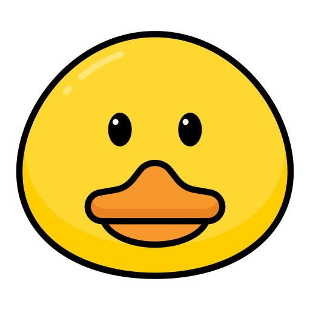

  

# Duck Interview

Duck Interview is a free, open-source web app for focused coding interview preparation. It brings quality practice questions and solutions together—without roadmaps, study sheets, or distractions.

I built this project for personal use, and it is not actively maintained. I may add more content and features, including system design, in the future.

[Visit on GitHub](https://github.com/ripanbaidya/duck-interview)